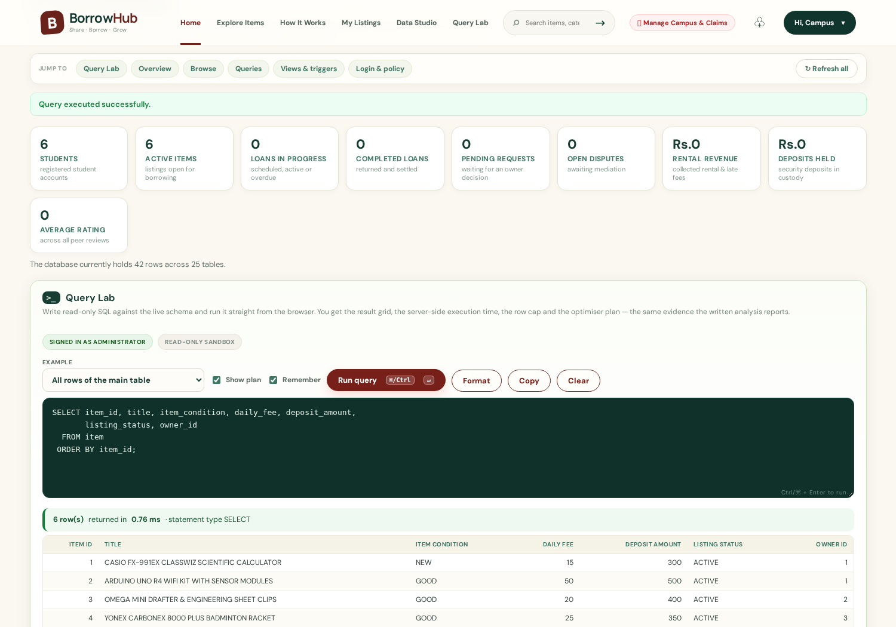

# BorrowHub — Complete Full-Stack Campus Resource Sharing Platform

[](https://fastapi.tiangolo.com)
[](https://python.org)
[](https://mysql.com)
[](backend/tests/)
[](LICENSE)

> **Share · Borrow · Grow**  
> A student-to-student resource-sharing marketplace designed specifically for **SVNIT Surat**.

---

## 1. Overview & Campus Context

Students on campus frequently need expensive tools, scientific equipment, academic books, sports gear, and electronics for brief periods—such as a Casio fx-991EX calculator during exam week, a mini-drafter for engineering drawing, lab coats for chemistry practicals, or a multimeter for electrical lab sessions. Purchasing these items brand new is costly and wasteful.

**BorrowHub** solves this with an authentic, student-to-student sharing economy platform tailored to the SVNIT community:
- **Verified Student Identity:** Restricted to official `@svnit.ac.in` and `@coed.svnit.ac.in` email addresses with OTP verification.
- **Fair, Independent Pricing:** Daily rental fees + refundable security deposit custody.
- **Physical Two-Party Handshake:** Cryptographic 6-digit OTP codes for verified pickup and return inspections.
- **Double-Booking Immunity:** Concurrency-protected calendar reservations enforced at the database level.
- **Reputation & Trust:** Peer reviews (1–5 stars) and automated trust score auditing.

---

## 2. Technology Stack

### Frontend
* **Core:** HTML5, CSS3, Vanilla JavaScript (ES2022)
* **Design Identity:** Custom SVNIT campus palette (Sage green `#3f7664`, Cream `#f8f6ef`, Terracotta coral `#f26355`, Forest ink `#183e34`)
* **Communication:** Fetch API with automatic JWT Bearer injection
* **Features:** Live date calculation, image upload preview gallery, responsive mobile navigation, modal dialogs

### Backend
* **Framework:** FastAPI (Python 3.10+)
* **ORM:** SQLAlchemy 2.x
* **Data Validation:** Pydantic V2
* **Migrations:** `database/schema.sql` is authoritative (tables, triggers, routines and views); Alembic holds a baseline marker for future incremental changes
* **Authentication:** Stateless JWT tokens (`PyJWT`) with Bcrypt password hashing
* **Rate Limiting:** Sliding-window rate limiter on authentication routes

### Database
* **Engine:** MySQL 8.0.16+ InnoDB
* **Integrity:** 30 native triggers, 27 stored procedures and 6 stored functions enforcing date availability, non-self borrowing, inspection checks and deposit settlement
* **Constraints:** Foreign keys with referential actions, check constraints on email domains and trust scores, composite unique index on `(item_id, booked_date)`

### External Integrations
* **Payments:** Razorpay Standard Checkout (Test Mode + Webhook verification)
* **Image Hosting:** Cloudinary CDN integration with local fallback support

---

## 3. High-Level Architecture & Lifecycle

```
[Student A (Owner)]                   [Student B (Borrower)]
       │                                       │
       │ 1. List Item (Casio fx-991EX)         │
       ├──────────────────────────────────────>│ (Marketplace)
       │                                       │
       │                                       │ 2. Select Dates & Submit Request
       │<──────────────────────────────────────┤    (Daily Fee: ₹10/day, Deposit: ₹200)
       │                                       │
       │ 3. Review & Approve Request           │
       ├──────────────────────────────────────>│ (Dates Reserved in BOOKED_DATE)
       │                                       │
       │                                       │ 4. Complete Payment (Rental + Deposit)
       │                                       │    (Status -> SCHEDULED)
       │                                       │    (Borrower receives Handover OTP: 729401)
       │                                       │
       │ 5. Physical Handover at Campus Spot   │
       │    Owner verifies Borrower's OTP      │
       │<──────────────────────────────────────┤
       │ (Status -> ACTIVE)                    │
       │                                       │
       │                                       │ 6. Use Item & Meet for Return
       │                                       │    (Borrower shares Return OTP: 834192)
       │ 7. Inspect Item & Verify Return OTP   │
       │    Deposit Settled (Full Refund)      │
       │<──────────────────────────────────────┤
       │ (Status -> RETURNED)                  │
       │                                       │
       │ 8. Mutual Peer Reviews (5 Stars ★)    │
       │<═════════════════════════════════════>│
```

---

## 4. Quickstart Guide

> **Note on Directory Location:** Always execute commands and scripts from the **project root folder** (do not `cd backend`). All modules, batch files, and configuration are structured for root execution.

### 1. Database Setup
```bash
# Connect to MySQL and apply the master schema & triggers
mysql -u root -p < database/schema.sql

# Load the campus seed data (users, categories, locations, sample items)
mysql -u root -p borrowhub < database/seed.sql

# Optional: run the SQL feature demo (SELECT / INSERT / aggregate / join /
# sub-query / correlated sub-query / UPDATE + index before-after profiling)
mysql -u root -p borrowhub < database/demo_queries.sql
```

### 2. Backend Dependencies
```bash
pip install -r backend/requirements.txt
```

### 3. Run Application Server
```bash
python -m uvicorn backend.app.main:app --host 0.0.0.0 --port 8000 --reload
```

* **Frontend Application:** `http://localhost:8000`
* **Swagger API Docs:** `http://localhost:8000/api/docs`
* **ReDoc Specifications:** `http://localhost:8000/api/redoc`

---

## 5. Pre-Configured Student Test Accounts

All pre-configured accounts use the default password: **`Svnit@2026!`**

| Name | Role | Email | Roll Number | Notes |
| :--- | :--- | :--- | :--- | :--- |
| **Priya Sharma** | `STUDENT` | `priya@coed.svnit.ac.in` | `U22CS001` | Item owner with active listings (Calculator, Drafter) |
| **Aarav Patel** | `STUDENT` | `aarav@coed.svnit.ac.in` | `U22CS014` | Borrower account ready to request items |
| **Rohit Verma** | `STUDENT` | `rohit@coed.svnit.ac.in` | `U22EE028` | Electrical student peer |
| **Admin User** | `ADMIN` | `admin@svnit.ac.in` | `SVNIT-ADMIN-01` | Platform moderation, audit logs & dispute resolution |

> **Pro-Tip:** In the web interface, click on the **Demo Quick Sign-In** chips (Priya, Aarav, Rohit, Admin) to authenticate instantly with 1 click!

### Database login accounts (privilege separation)

`database/schema.sql` also creates the three MySQL logins used for the
role-based access demonstration. They are **database** accounts, unrelated to
the student logins above:

| Login | Password | Role | What it may do |
| :--- | :--- | :--- | :--- |
| `borrowhub_naive` | `Naive@2026!` | `borrowhub_naive_role` | `SELECT` on `vw_item_availability` only |
| `borrowhub_dev` | `Developer@2026!` | `borrowhub_developer_role` | `SELECT/INSERT/UPDATE/DELETE/EXECUTE` on `borrowhub.*` |
| `borrowhub_dba` | `Dba@2026!` | `borrowhub_dba_role` | `ALL PRIVILEGES` on `borrowhub.*` |

Try `mysql -u borrowhub_naive -p'Naive@2026!' -e "SELECT * FROM borrowhub.item"` —
the server refuses it, while the same query succeeds for `borrowhub_dev`.

---

## 6. Automated Test Suite

BorrowHub includes a comprehensive pytest test suite verifying all critical business flows:

```bash
python -m pytest backend/tests -v
```

### Test Coverage Highlights:
- ✅ `test_admin_endpoints_access_control`: Role-based access control (403 for non-admins).
- ✅ `test_admin_user_moderation`: Admin account suspension and status management.
- ✅ `test_login_success` & `test_login_wrong_password`: Valid credentials and rejection.
- ✅ `test_register_invalid_domain`: Rejection of non-SVNIT emails.
- ✅ `test_register_duplicate_email`: Prevention of duplicate account creation.
- ✅ `test_register_and_verify_success`: OTP verification and activation flow.
- ✅ `test_unauthorized_access`: Protection of private endpoints.
- ✅ `test_self_borrowing_prevention`: Rejection of requests by owners on their own items.
- ✅ `test_complete_borrow_loan_and_return_lifecycle`: Full end-to-end borrowing, approval, payment, handover OTP handshake, return OTP handshake, deposit settlement, and review creation.
- ✅ `test_list_categories_and_locations`: Database-backed categories and pickup spots.
- ✅ `test_create_and_manage_item`: Item CRUD, search query, and category filters.
- ✅ `test_payment_flow`: Razorpay order creation, signature verification, and cash fallback.
- ✅ `test_forgot_password_two_step_reset_flow`: Two-step OTP password reset.
- ✅ `test_query_lab_*` (10 tests): read-only enforcement, stacked-statement block, confidential-column block, system-schema block, row cap, readable SQL errors and "every curated example actually runs".
- ✅ `test_upload_*` (2 tests): a fake JPEG (HTML payload) is rejected, a real PNG is accepted.

**Total: 26 tests, all passing** (`26 passed`).

> The suite runs against a throw-away database (`borrowhub_test`) that it rebuilds
> from `database/schema.sql` + `database/seed.sql` at the start of every run, so
> running the tests never touches the rows your application is using. Set
> `BORROWHUB_TEST_DATABASE=0` to opt out.

---

## 7. Project Documentation Index

Detailed documentation files are available in the [`docs/`](docs/) directory:
* [API Documentation (`docs/API_DOCUMENTATION.md`)](docs/API_DOCUMENTATION.md): Complete REST endpoint guide with request and response payloads.
* [Database Architecture (`docs/DATABASE_DESIGN.md`)](docs/DATABASE_DESIGN.md): Schema design, ER diagram, full table dictionary, 7 views, 30 triggers and 33 stored routines.
* [Security Assessment (`docs/SECURITY_ASSESSMENT.md`)](docs/SECURITY_ASSESSMENT.md): Zero-trust security model, OTP cryptographic hashing, and threat mitigation.
* [Payment & Cloudinary Guide (`docs/PAYMENT_AND_CLOUDINARY_GUIDE.md`)](docs/PAYMENT_AND_CLOUDINARY_GUIDE.md): Razorpay test/live setup and Cloudinary media upload.
* [Query Performance Analysis (`docs/QUERY_PERFORMANCE_ANALYSIS.md`)](docs/QUERY_PERFORMANCE_ANALYSIS.md): Measured `SHOW PROFILES` / `EXPLAIN` results for the eight core statements and the impact of the reporting indexes.
* [Deployment Guide (`docs/DEPLOYMENT.md`)](docs/DEPLOYMENT.md): Local development and production deployment (Docker, Nginx, Railway/Render).

---

## 8. Data Studio — In-App Database Explorer

Apart from the student-facing marketplace, the app ships a built-in **Data Studio**
(the *Data Studio* tab in the navigation bar, `frontend/studio.js`) that exposes the
database layer live, without leaving the product:

* **Dashboard** — row count of every table plus headline figures (students, active
  listings, loans in progress, revenue collected, deposits held, average rating).
  The counts come from the stored procedure `sp_application_statistics`.
* **Table browser** — page through any of the 25 base tables; the same page is
  also available as XML (`?fmt=xml`).
* **Query builder** — aggregate (`SUM/AVG/COUNT/MIN/MAX`), conditional filter,
  multi-table sub-query, correlated sub-query and a configurable two-table join.
* **View explorer** — read any of the 7 views, insert a row through a single-table
  view, and trigger an `UPDATE` that deliberately violates a trigger rule to show
  the constraint rejecting it.
* **Login record & office-hours guard** — the signed-in user's login record is
  read through `sp_user_login_data`, and the trigger that blocks borrow-request
  changes outside campus office hours is switched on/off from the panel
  (`sp_set_office_hours_guard`).
* **Query Lab** — a SQL console in the browser: run any read-only statement
  (`SELECT`, `WITH`, `SHOW`, `DESCRIBE`, `EXPLAIN`), see the result grid, the
  server-side execution time, a 500-row cap and the optimiser plan, with
  16 curated examples, recent-query history, one-click formatting, copy and CSV
  export. See [§9](#9-query-lab--sql-console).
* **Stored routine catalogue** — the 27 procedures and 6 functions with their
  signatures.

The studio is backed by 12 paths under `/api/explorer` plus the admin
configuration endpoints, 73 API operations in total across the application,
documented in Swagger at `/api/docs`.

---

## 9. Query Lab — SQL console

The **Query Lab** tab (`#query-lab`, `frontend/studio.js`, `backend/app/routes/query_lab.py`)
runs SQL straight from the browser against the live schema — useful for a demo or a
viva, because the result grid, the timing and the plan all come back from the server.

### What you get




| Feature | Detail |
|---|---|
| Editor | Monospace SQL editor, `Ctrl/⌘ + Enter` to run, **Format** to normalise keywords |
| Execution | Server-side timing (`execution_ms`), row count, statement type |
| Result grid | Sticky header, right-aligned numerics, `NULL` styling, **Export CSV** |
| Plan | `EXPLAIN` output plus the list of indexes the optimiser actually used |
| Examples | 16 curated statements in 3 groups (statement set / schema & performance / views) |
| History | Last 8 statements kept in `localStorage`, one click to restore |
| Safety | Read-only sandbox (see below) |

### Safety model

1. **Administrator session only** — `get_current_admin`, so a student session gets `403`.
2. **Statement allow-list** — must start with `SELECT`, `WITH`, `SHOW`, `DESCRIBE`/`DESC`
   or `EXPLAIN`; `INSERT`, `UPDATE`, `DELETE`, `DROP`, `ALTER`, `CALL`, `SET`, … are refused
   before they reach the driver.
3. **Single statement** — stacked queries (`SELECT 1; DROP TABLE item`) and
   comment-hidden variants are rejected.
4. **Confidential columns blocked** — `password_hash`, `token_hash`, `otp_code`,
   `handover_otp_hash`, … can never be projected; the `mysql` / `sys` /
   `performance_schema` schemas are blocked.
5. **Execution guard** — a per-session statement timeout (8 s) and a 500-row cap
   (`truncated` is reported back, never a silent cut).

Statements and the guards are covered by `backend/tests/test_query_lab.py`.


---

### 9b. Deploy (public demo)

Publishing a demo link? This setup is break-proof: visitors can create anything, the data
is reset every night, and payments always stay simulated.

* **Guide:** [`docs/DEPLOYMENT_PAAS.md`](docs/DEPLOYMENT_PAAS.md) (Render + Aiven MySQL, step by step)
* **Ready-made files:** `Dockerfile`, `render.yaml` (web service + nightly reset cron),
  `railway.json`, `Procfile`, `.env.production.example`, `.github/workflows/ci.yml`
* **PaaS-safe SQL:** `database/schema_paas.sql` + `seed_paas.sql` (managed MySQL does not
  allow `DROP DATABASE` / `GRANT`)
* **Reset:** `python scripts/reset_demo.py` or `POST /api/internal/reset-demo`
  (with the `X-Demo-Reset-Token` header)
* **Demo mode:** `DEMO_MODE=true` → payments always simulated + OTP returned to the browser
* **Evaluator handout:** [`docs/DEMO_GUIDE.md`](docs/DEMO_GUIDE.md)

---

# 10. Troubleshooting

If something does not work, run this read-only diagnostic first:

```bash
python diagnose_login.py
```

It checks the location of `.env`, `DATABASE_URL`, the MySQL connection, the seed accounts
and password hashes, schema completeness (tables + routines + triggers) and the exact
response of `/api/auth/login` — and prints the fix for every problem it finds.

Detailed guide: [`docs/TROUBLESHOOTING.md`](docs/TROUBLESHOOTING.md) — 401 vs 503 vs 500,
`backend/.env` vs a root `.env`, an incomplete `schema.sql` run in Workbench, etc.
