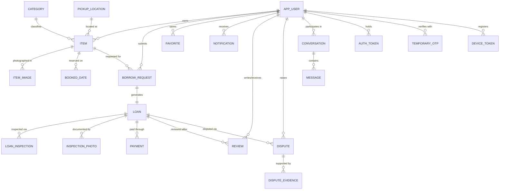

# BorrowHub — Database Architecture & Schema Design

**Target RDBMS:** MySQL 8.0.16+ / MariaDB 10.6+ (InnoDB, `utf8mb4`)  
**Master schema:** `database/schema.sql` · **Seed data:** `database/seed.sql` · **Query & index demo:** `database/demo_queries.sql`

**Inventory (generated from the running schema):** 25 tables · 7 views · 30 triggers · 27 stored procedures · 6 stored functions.

---

## 1. Entity-Relationship Overview

---

## 2. Table Dictionary

### `application_audit_log`

| Column | Type | Null | Key | Default / Extra |
|---|---|---|---|---|
| `log_id` | `bigint(20)` | NO | PRI | auto_increment |
| `actor_id` | `int(11)` | YES | MUL | — |
| `action` | `varchar(60)` | NO | — | — |
| `entity_type` | `varchar(40)` | NO | MUL | — |
| `entity_id` | `bigint(20)` | NO | — | — |
| `old_value` | `longtext` | YES | — | — |
| `new_value` | `longtext` | YES | — | — |
| `created_at` | `datetime` | NO | — | utc_timestamp() |

*Foreign keys:*

- `actor_id` → `app_user.user_id`

### `app_config`

| Column | Type | Null | Key | Default / Extra |
|---|---|---|---|---|
| `config_key` | `varchar(60)` | NO | PRI | — |
| `config_value` | `varchar(255)` | NO | — | — |
| `description` | `varchar(255)` | YES | — | — |
| `updated_at` | `datetime` | NO | — | utc_timestamp() |

### `app_user`

| Column | Type | Null | Key | Default / Extra |
|---|---|---|---|---|
| `user_id` | `int(11)` | NO | PRI | auto_increment |
| `roll_number` | `varchar(30)` | NO | UNI | — |
| `full_name` | `varchar(120)` | NO | — | — |
| `svnit_email` | `varchar(254)` | NO | UNI | — |
| `phone` | `varchar(20)` | YES | — | — |
| `hostel_or_dept` | `varchar(100)` | YES | MUL | — |
| `password_hash` | `varchar(255)` | NO | — | — |
| `role` | `enum('STUDENT','MODERATOR','ADMIN')` | NO | — | 'STUDENT' |
| `is_verified` | `tinyint(1)` | NO | — | 0 |
| `is_active` | `tinyint(1)` | NO | — | 1 |
| `password_changed_at` | `datetime` | YES | — | — |
| `created_at` | `datetime` | NO | — | utc_timestamp() |
| `updated_at` | `datetime` | NO | — | utc_timestamp() |
| `deleted_at` | `datetime` | YES | — | — |

### `auth_token`

| Column | Type | Null | Key | Default / Extra |
|---|---|---|---|---|
| `token_id` | `bigint(20)` | NO | PRI | auto_increment |
| `user_id` | `int(11)` | NO | MUL | — |
| `token_type` | `enum('EMAIL_OTP','PASSWORD_RESET','REFRESH')` | NO | — | — |
| `token_hash` | `char(64)` | NO | MUL | — |
| `expires_at` | `datetime` | NO | — | — |
| `used_at` | `datetime` | YES | — | — |
| `created_at` | `datetime` | NO | — | utc_timestamp() |

*Foreign keys:*

- `user_id` → `app_user.user_id`

### `booked_date`

| Column | Type | Null | Key | Default / Extra |
|---|---|---|---|---|
| `item_id` | `int(11)` | NO | PRI | — |
| `booked_date` | `date` | NO | PRI | — |
| `request_id` | `int(11)` | NO | MUL | — |

*Foreign keys:*

- `request_id` → `borrow_request.request_id`
- `item_id` → `item.item_id`

### `borrow_request`

| Column | Type | Null | Key | Default / Extra |
|---|---|---|---|---|
| `request_id` | `int(11)` | NO | PRI | auto_increment |
| `item_id` | `int(11)` | NO | MUL | — |
| `borrower_id` | `int(11)` | NO | MUL | — |
| `start_date` | `date` | NO | — | — |
| `end_date` | `date` | NO | — | — |
| `request_message` | `text` | YES | — | — |
| `status` | `enum('PENDING','APPROVED','REJECTED','CANCELLED')` | NO | — | 'PENDING' |
| `requested_at` | `datetime` | NO | — | utc_timestamp() |
| `decided_at` | `datetime` | YES | — | — |
| `decision_note` | `text` | YES | — | — |

*Foreign keys:*

- `item_id` → `item.item_id`
- `borrower_id` → `app_user.user_id`

### `category`

| Column | Type | Null | Key | Default / Extra |
|---|---|---|---|---|
| `category_id` | `int(11)` | NO | PRI | auto_increment |
| `category_name` | `varchar(80)` | NO | UNI | — |
| `category_description` | `text` | YES | — | — |

### `conversation`

| Column | Type | Null | Key | Default / Extra |
|---|---|---|---|---|
| `conversation_id` | `int(11)` | NO | PRI | auto_increment |
| `item_id` | `int(11)` | NO | MUL | — |
| `borrower_id` | `int(11)` | NO | MUL | — |
| `created_at` | `datetime` | NO | — | utc_timestamp() |
| `last_message_at` | `datetime` | YES | — | — |

*Foreign keys:*

- `item_id` → `item.item_id`
- `borrower_id` → `app_user.user_id`

### `device_token`

| Column | Type | Null | Key | Default / Extra |
|---|---|---|---|---|
| `device_id` | `int(11)` | NO | PRI | auto_increment |
| `user_id` | `int(11)` | NO | MUL | — |
| `platform` | `enum('ANDROID','IOS','WEB')` | NO | — | — |
| `push_token` | `varchar(512)` | NO | UNI | — |
| `is_active` | `tinyint(1)` | NO | — | 1 |
| `last_seen_at` | `datetime` | YES | — | — |
| `created_at` | `datetime` | NO | — | utc_timestamp() |

*Foreign keys:*

- `user_id` → `app_user.user_id`

### `dispute`

| Column | Type | Null | Key | Default / Extra |
|---|---|---|---|---|
| `dispute_id` | `int(11)` | NO | PRI | auto_increment |
| `loan_id` | `int(11)` | NO | MUL | — |
| `raised_by` | `int(11)` | NO | MUL | — |
| `against_user_id` | `int(11)` | NO | MUL | — |
| `inspection_id` | `int(11)` | YES | MUL | — |
| `resolved_by` | `int(11)` | YES | MUL | — |
| `dispute_type` | `enum('DAMAGE','NO_SHOW','LATE_RETURN','NON_PAYMENT','OTHER')` | NO | — | — |
| `description` | `text` | NO | — | — |
| `status` | `enum('OPEN','UNDER_REVIEW','RESOLVED','REJECTED')` | NO | MUL | 'OPEN' |
| `amount_claimed` | `decimal(10,2)` | NO | — | 0.00 |
| `amount_awarded` | `decimal(10,2)` | NO | — | 0.00 |
| `resolution_note` | `text` | YES | — | — |
| `created_at` | `datetime` | NO | — | utc_timestamp() |
| `resolved_at` | `datetime` | YES | — | — |

*Foreign keys:*

- `resolved_by` → `app_user.user_id`
- `inspection_id` → `loan_inspection.inspection_id`
- `raised_by` → `app_user.user_id`
- `against_user_id` → `app_user.user_id`
- `loan_id` → `loan.loan_id`

### `dispute_evidence`

| Column | Type | Null | Key | Default / Extra |
|---|---|---|---|---|
| `evidence_id` | `int(11)` | NO | PRI | auto_increment |
| `dispute_id` | `int(11)` | NO | MUL | — |
| `image_url` | `varchar(2048)` | NO | — | — |
| `uploaded_at` | `datetime` | NO | — | utc_timestamp() |

*Foreign keys:*

- `dispute_id` → `dispute.dispute_id`

### `favorite`

| Column | Type | Null | Key | Default / Extra |
|---|---|---|---|---|
| `user_id` | `int(11)` | NO | PRI | — |
| `item_id` | `int(11)` | NO | PRI | — |
| `created_at` | `datetime` | NO | — | utc_timestamp() |

*Foreign keys:*

- `user_id` → `app_user.user_id`
- `item_id` → `item.item_id`

### `inspection_photo`

| Column | Type | Null | Key | Default / Extra |
|---|---|---|---|---|
| `photo_id` | `int(11)` | NO | PRI | auto_increment |
| `inspection_id` | `int(11)` | NO | MUL | — |
| `image_url` | `varchar(2048)` | NO | — | — |
| `uploaded_at` | `datetime` | NO | — | utc_timestamp() |

*Foreign keys:*

- `inspection_id` → `loan_inspection.inspection_id`

### `item`

| Column | Type | Null | Key | Default / Extra |
|---|---|---|---|---|
| `item_id` | `int(11)` | NO | PRI | auto_increment |
| `owner_id` | `int(11)` | NO | MUL | — |
| `category_id` | `int(11)` | NO | MUL | — |
| `location_id` | `int(11)` | NO | MUL | — |
| `title` | `varchar(160)` | NO | MUL | — |
| `description` | `text` | YES | — | — |
| `item_condition` | `enum('NEW','GOOD','FAIR','WORN','DAMAGED')` | NO | — | 'GOOD' |
| `deposit_amount` | `decimal(10,2)` | NO | — | 0.00 |
| `daily_fee` | `decimal(10,2)` | NO | MUL | 0.00 |
| `max_borrow_days` | `int(11)` | NO | — | 1 |
| `listing_status` | `enum('ACTIVE','PAUSED','ARCHIVED')` | NO | — | 'ACTIVE' |
| `created_at` | `datetime` | NO | — | utc_timestamp() |
| `updated_at` | `datetime` | NO | — | utc_timestamp() |
| `deleted_at` | `datetime` | YES | — | — |

*Foreign keys:*

- `location_id` → `pickup_location.location_id`
- `category_id` → `category.category_id`
- `owner_id` → `app_user.user_id`

### `item_image`

| Column | Type | Null | Key | Default / Extra |
|---|---|---|---|---|
| `image_id` | `int(11)` | NO | PRI | auto_increment |
| `item_id` | `int(11)` | NO | MUL | — |
| `image_url` | `varchar(2048)` | NO | — | — |
| `sort_order` | `smallint(5) unsigned` | NO | — | 0 |
| `is_primary` | `tinyint(1)` | NO | — | 0 |
| `uploaded_at` | `datetime` | NO | — | utc_timestamp() |

*Foreign keys:*

- `item_id` → `item.item_id`

### `loan`

| Column | Type | Null | Key | Default / Extra |
|---|---|---|---|---|
| `loan_id` | `int(11)` | NO | PRI | auto_increment |
| `request_id` | `int(11)` | NO | UNI | — |
| `status` | `enum('SCHEDULED','ACTIVE','OVERDUE','RETURNED','CANCELLED')` | NO | MUL | 'SCHEDULED' |
| `issued_at` | `datetime` | YES | — | — |
| `due_at` | `datetime` | NO | — | — |
| `returned_at` | `datetime` | YES | — | — |
| `agreed_daily_fee` | `decimal(10,2)` | NO | — | — |
| `agreed_deposit` | `decimal(10,2)` | NO | — | — |
| `agreed_total_fee` | `decimal(10,2)` | NO | — | — |
| `late_fee` | `decimal(10,2)` | NO | — | 0.00 |
| `deposit_status` | `enum('NOT_PAID','HELD','RELEASED','FORFEITED','PARTIAL')` | NO | — | 'NOT_PAID' |
| `deposit_deducted` | `decimal(10,2)` | NO | — | 0.00 |
| `handover_otp_hash` | `char(64)` | NO | — | — |
| `return_otp_hash` | `char(64)` | NO | — | — |
| `created_at` | `datetime` | NO | — | utc_timestamp() |

*Foreign keys:*

- `request_id` → `borrow_request.request_id`

### `loan_inspection`

| Column | Type | Null | Key | Default / Extra |
|---|---|---|---|---|
| `inspection_id` | `int(11)` | NO | PRI | auto_increment |
| `loan_id` | `int(11)` | NO | MUL | — |
| `stage` | `enum('HANDOVER','RETURN')` | NO | — | — |
| `inspected_by` | `int(11)` | NO | MUL | — |
| `confirmed_by` | `int(11)` | YES | MUL | — |
| `condition_found` | `enum('NEW','GOOD','FAIR','WORN','DAMAGED')` | NO | — | — |
| `notes` | `text` | YES | — | — |
| `counterparty_notes` | `text` | YES | — | — |
| `owner_agreed` | `tinyint(1)` | NO | — | 0 |
| `owner_agreed_at` | `datetime` | YES | — | — |
| `borrower_agreed` | `tinyint(1)` | NO | — | 0 |
| `borrower_agreed_at` | `datetime` | YES | — | — |
| `provided_otp_hash` | `char(64)` | YES | — | — |
| `otp_verified` | `tinyint(1)` | NO | — | 0 |
| `inspection_status` | `enum('PENDING_COUNTERPARTY','VERIFIED','DISPUTED')` | NO | — | 'PENDING_COUNTERPARTY' |
| `inspected_at` | `datetime` | NO | — | utc_timestamp() |
| `verified_at` | `datetime` | YES | — | — |

*Foreign keys:*

- `inspected_by` → `app_user.user_id`
- `confirmed_by` → `app_user.user_id`
- `loan_id` → `loan.loan_id`

### `message`

| Column | Type | Null | Key | Default / Extra |
|---|---|---|---|---|
| `message_id` | `bigint(20)` | NO | PRI | auto_increment |
| `conversation_id` | `int(11)` | NO | MUL | — |
| `sender_id` | `int(11)` | NO | MUL | — |
| `body` | `text` | NO | — | — |
| `sent_at` | `datetime` | NO | — | utc_timestamp() |
| `read_at` | `datetime` | YES | — | — |

*Foreign keys:*

- `sender_id` → `app_user.user_id`
- `conversation_id` → `conversation.conversation_id`

### `notification`

| Column | Type | Null | Key | Default / Extra |
|---|---|---|---|---|
| `notif_id` | `bigint(20)` | NO | PRI | auto_increment |
| `user_id` | `int(11)` | NO | MUL | — |
| `related_request_id` | `int(11)` | YES | MUL | — |
| `related_loan_id` | `int(11)` | YES | MUL | — |
| `reference_type` | `enum('REQUEST','loan','payment','review','dispute','SYSTEM')` | NO | MUL | 'SYSTEM' |
| `reference_id` | `bigint(20)` | YES | — | — |
| `type` | `enum('REQUEST_RECEIVED','REQUEST_APPROVED','REQUEST_REJECTED','REQUEST_CANCELLED','LOAN_STARTED','LOAN_OVERDUE','LOAN_RETURNED','PAYMENT_UPDATE','REVIEW_RECEIVED','DISPUTE_UPDATE','SYSTEM')` | NO | — | — |
| `title` | `varchar(150)` | NO | — | — |
| `message` | `text` | NO | — | — |
| `is_read` | `tinyint(1)` | NO | — | 0 |
| `created_at` | `datetime` | NO | — | utc_timestamp() |

*Foreign keys:*

- `related_request_id` → `borrow_request.request_id`
- `related_loan_id` → `loan.loan_id`
- `user_id` → `app_user.user_id`

### `payment`

| Column | Type | Null | Key | Default / Extra |
|---|---|---|---|---|
| `payment_id` | `int(11)` | NO | PRI | auto_increment |
| `loan_id` | `int(11)` | NO | MUL | — |
| `payer_id` | `int(11)` | NO | MUL | — |
| `payee_id` | `int(11)` | NO | MUL | — |
| `payment_type` | `enum('RENTAL_FEE','DEPOSIT','LATE_FEE','DAMAGE_CHARGE','DAMAGE_DEDUCTION','REFUND')` | NO | — | — |
| `method` | `enum('UPI','CARD','CASH')` | NO | — | — |
| `payment_status` | `enum('PENDING','COMPLETED','FAILED')` | NO | — | 'PENDING' |
| `amount` | `decimal(10,2)` | NO | — | — |
| `refund_for_payment_id` | `int(11)` | YES | MUL | — |
| `refund_reason` | `enum('CANCELLED_LOAN','DEPOSIT_SETTLEMENT','DISPUTE_AWARD','OVERPAYMENT')` | YES | — | — |
| `confirmed_by_user_id` | `int(11)` | YES | MUL | — |
| `gateway_order_id` | `varchar(100)` | YES | MUL | — |
| `transaction_reference` | `varchar(160)` | YES | UNI | — |
| `idempotency_key` | `varchar(100)` | YES | UNI | — |
| `created_at` | `datetime` | NO | — | utc_timestamp() |
| `paid_at` | `datetime` | YES | — | — |

*Foreign keys:*

- `loan_id` → `loan.loan_id`
- `payer_id` → `app_user.user_id`
- `confirmed_by_user_id` → `app_user.user_id`
- `payee_id` → `app_user.user_id`
- `refund_for_payment_id` → `payment.payment_id`

### `payment_webhook_event`

| Column | Type | Null | Key | Default / Extra |
|---|---|---|---|---|
| `event_id` | `bigint(20)` | NO | PRI | auto_increment |
| `payment_id` | `int(11)` | NO | MUL | — |
| `gateway_event_id` | `varchar(160)` | NO | UNI | — |
| `event_type` | `enum('PAYMENT_CAPTURED','PAYMENT_FAILED','REFUND_PROCESSED')` | NO | — | — |
| `amount_reported` | `decimal(10,2)` | NO | — | — |
| `transaction_reference` | `varchar(160)` | NO | — | — |
| `signature_verified` | `tinyint(1)` | NO | — | 0 |
| `event_status` | `enum('RECEIVED','VERIFIED','REJECTED')` | NO | — | 'RECEIVED' |
| `payload` | `longtext` | NO | — | — |
| `received_at` | `datetime` | NO | — | utc_timestamp() |
| `processed_at` | `datetime` | YES | — | — |

*Foreign keys:*

- `payment_id` → `payment.payment_id`

### `pickup_location`

| Column | Type | Null | Key | Default / Extra |
|---|---|---|---|---|
| `location_id` | `int(11)` | NO | PRI | auto_increment |
| `name` | `varchar(100)` | NO | UNI | — |
| `description` | `varchar(255)` | YES | — | — |

### `review`

| Column | Type | Null | Key | Default / Extra |
|---|---|---|---|---|
| `review_id` | `int(11)` | NO | PRI | auto_increment |
| `loan_id` | `int(11)` | NO | MUL | — |
| `reviewer_id` | `int(11)` | NO | MUL | — |
| `reviewee_id` | `int(11)` | NO | MUL | — |
| `rating` | `tinyint(3) unsigned` | NO | — | — |
| `review_text` | `text` | YES | — | — |
| `created_at` | `datetime` | NO | — | utc_timestamp() |

*Foreign keys:*

- `loan_id` → `loan.loan_id`
- `reviewer_id` → `app_user.user_id`
- `reviewee_id` → `app_user.user_id`

### `system_job_log`

| Column | Type | Null | Key | Default / Extra |
|---|---|---|---|---|
| `job_run_id` | `bigint(20)` | NO | PRI | auto_increment |
| `job_name` | `varchar(60)` | NO | MUL | — |
| `triggered_by` | `enum('EVENT_SCHEDULER','ON_DEMAND','CRON')` | NO | — | 'ON_DEMAND' |
| `overdue_marked` | `int(11)` | NO | — | 0 |
| `requests_expired` | `int(11)` | NO | — | 0 |
| `no_shows_expired` | `int(11)` | NO | — | 0 |
| `tokens_purged` | `int(11)` | NO | — | 0 |
| `ran_at` | `datetime` | NO | — | utc_timestamp() |

### `temporary_otp`

| Column | Type | Null | Key | Default / Extra |
|---|---|---|---|---|
| `otp_id` | `int(11)` | NO | PRI | auto_increment |
| `loan_id` | `int(11)` | NO | MUL | — |
| `stage` | `varchar(20)` | NO | — | — |
| `otp_code` | `varchar(10)` | NO | — | — |
| `expires_at` | `datetime` | NO | — | — |
| `created_at` | `datetime` | NO | — | utc_timestamp() |

*Foreign keys:*

- `loan_id` → `loan.loan_id`

---

## 3. Views

| View | Purpose |
|---|---|
| `vw_active_items` | Every ACTIVE, non-deleted listing joined to its owner, category and pickup location. |
| `vw_bhabha_bhavan_items` | Single-hostel slice of `vw_active_items` (Bhabha Bhavan), used by the Data Studio view demo. |
| `vw_item_availability` | `item` joined with `booked_date`, showing whether each item is free for a given day via `fn_item_is_available`. |
| `vw_loan_details` | Denormalised loan report: borrower, owner, item, dates, fees and statuses. |
| `vw_loan_financial_ledger` | Per-loan money view: agreed fee, deposit held, payments received, refunds, outstanding. |
| `vw_scheduler_health` | Last run of every system job from `system_job_log`. |
| `vw_user_trust_score` | Student trust score with counts of loans, reviews and disputes. |

---

## 4. Triggers

Business rules are enforced at the SQL layer through **30 triggers**, so they hold even when a client bypasses the API.

| Trigger | Timing | Event | Table | Rule enforced |
|---|---|---|---|---|
| `trg_app_user_au` | AFTER | UPDATE | `app_user` | When a user is deactivated or soft-deleted, all of their listings are set to `PAUSED` and their conversations are closed. |
| `trg_app_user_bu` | BEFORE | UPDATE | `app_user` | Stamps `updated_at`; blocks soft-delete while the user still has open loans, bookings or pending requests. |
| `trg_request_ai` | AFTER | INSERT | `borrow_request` | Notifies the item owner that a new borrow request arrived. |
| `trg_request_au` | AFTER | UPDATE | `borrow_request` | On approval, materialises `booked_date` rows for the requested range and creates the `loan` with the agreed fee/deposit. |
| `trg_request_bi` | BEFORE | INSERT | `borrow_request` | Rejects self-borrowing, unverified/inactive owners, paused or deleted items, past start dates, ranges longer than `max_borrow_days`, and conflicting dates. |
| `trg_request_bu` | BEFORE | UPDATE | `borrow_request` | Freezes the identity columns of a request; only a status transition on an unlocked request is allowed. |
| `trg_restrict_office_hours` | BEFORE | UPDATE | `borrow_request` | Blocks request creation outside campus office hours when `app_config.office_hours_guard` is enabled (IST aware). |
| `trg_conversation_bi` | BEFORE | INSERT | `conversation` | A conversation may only be started on a live item and only by the borrower or the owner. |
| `trg_dispute_au` | AFTER | UPDATE | `dispute` | Notifies the raiser on every dispute status change. |
| `trg_dispute_bi` | BEFORE | INSERT | `dispute` | A dispute may only be raised on a `RETURNED` / `ACTIVE` loan and only by a party to that loan. |
| `trg_dispute_bu` | BEFORE | UPDATE | `dispute` | Locks `loan_id`, `raised_by` and `against_user_id` — a dispute cannot be re-pointed. |
| `trg_item_au` | AFTER | UPDATE | `item` | Writes an `ITEM_CHANGED` row into `application_audit_log` whenever fee, deposit, condition or status changes. |
| `trg_item_bi` | BEFORE | INSERT | `item` | An item can only be listed by a verified, active, non-deleted owner. |
| `trg_item_uppercase_title` | BEFORE | INSERT | `item` | `INSERT`: normalises `title` to upper case. |
| `trg_item_uppercase_title_bu` | BEFORE | UPDATE | `item` | `UPDATE`: keeps `title` upper case. |
| `trg_item_bu` | BEFORE | UPDATE | `item` | Ownership is immutable; an item with an open loan cannot be paused, archived or soft-deleted. |
| `trg_loan_au` | AFTER | UPDATE | `loan` | Notifies borrower and owner on every loan status change (ACTIVE, OVERDUE, RETURNED…). |
| `trg_loan_bi` | BEFORE | INSERT | `loan` | Forces a new loan to start as `SCHEDULED` with no issue/return timestamp, zero late fee and `deposit_status = NOT_PAID`. |
| `trg_loan_bu` | BEFORE | UPDATE | `loan` | Freezes `request_id`, `due_at`, `agreed_daily_fee` and `agreed_deposit` after creation; status changes must come from verified inspections. |
| `trg_inspection_au` | AFTER | UPDATE | `loan_inspection` | When the counterparty verifies the handover, flips the loan to `ACTIVE` and the item to `BORROWED`. |
| `trg_inspection_bd` | BEFORE | DELETE | `loan_inspection` | `DELETE`: inspections are immutable evidence and can never be removed. |
| `trg_inspection_bi` | BEFORE | INSERT | `loan_inspection` | Handover cannot happen before `start_date`, and only after the rental fee is `COMPLETED` and the deposit is `HELD`. |
| `trg_inspection_bu` | BEFORE | UPDATE | `loan_inspection` | Locks the inspection row; the counterparty must submit the correct OTP hash to move it to `VERIFIED`. |
| `trg_message_ai` | AFTER | INSERT | `message` | Keeps `conversation.last_message_at` in sync on every new message. |
| `trg_message_bi` | BEFORE | INSERT | `message` | Only the two participants of a conversation may post into it. |
| `trg_payment_au` | AFTER | UPDATE | `payment` | A completed `DEPOSIT` payment moves the loan to `deposit_status = HELD`; a refund updates the loan accordingly. |
| `trg_payment_bi` | BEFORE | INSERT | `payment` | Financial integrity: `RENTAL_FEE` must equal `loan.agreed_total_fee`, `DEPOSIT` must equal `loan.agreed_deposit`, payer/payee must be the loan's parties. |
| `trg_payment_bu` | BEFORE | UPDATE | `payment` | Freezes the amount, type, payer and payee of an existing payment; only webhook-verified rows may change status. |
| `trg_review_ai` | AFTER | INSERT | `review` | Notifies the reviewee that a review was received. |
| `trg_review_bi` | BEFORE | INSERT | `review` | A review is only allowed after the loan is `RETURNED`, only by a party to it, and only once per reviewer per loan. |

---

## 5. Stored Procedures & Functions

| Routine | Type | Purpose |
|---|---|---|
| `fn_campus_day_end_utc` | FUNCTION | UTC timestamp of 23:59:59 IST for a given campus day. |
| `fn_campus_today` | FUNCTION | Current date in IST, independent of the server time zone. |
| `fn_item_is_available` | FUNCTION | `1` when the item has no overlapping `booked_date` row for the requested range. |
| `fn_search_items_count` | FUNCTION | Count of items matching a free-text search plus category/location filters. |
| `fn_sum_column_total` | FUNCTION | Generic column total used by the aggregate screen (safe, whitelist-checked). |
| `fn_sum_deposits_by_category` | FUNCTION | Total deposit value held per category. |
| `sp_application_statistics` | PROCEDURE | Result-set of row counts for every table (used by the Data Studio dashboard). |
| `sp_approve_request` | PROCEDURE | Validates availability, books the dates and initialises the loan in one atomic transaction. |
| `sp_cancel_request` | PROCEDURE | Cancels a pending/approved request, releases the booked dates and notifies the other party. |
| `sp_confirm_cash_payment` | PROCEDURE | Marks a cash settlement as received after the office verifies it. |
| `sp_confirm_inspection` | PROCEDURE | Validates the SHA-256 hash of the submitted 6-digit OTP against the loan's handover/return hash. |
| `sp_create_role_user` | PROCEDURE | Creates a user with an explicit role (admin tooling). |
| `sp_create_user` | PROCEDURE | Registers a student with a hashed password and verification defaults. |
| `sp_cursor_items_unlimited` | PROCEDURE | Demo: opens a cursor over the whole `item` table and prints each row. |
| `sp_cursor_items_with_limit` | PROCEDURE | Demo: cursor over `item` with a row limit, showing `LIMIT`-style pagination. |
| `sp_deposit_totals_by_category` | PROCEDURE | Aggregate report: sum and average deposit per category. |
| `sp_insert_item` | PROCEDURE | Inserts an item through a procedure, used by the Data Studio demo. |
| `sp_normalize_item_titles` | PROCEDURE | Maintenance: re-applies the upper-case title rule to every row. |
| `sp_process_payment_webhook` | PROCEDURE | Idempotently records and applies a gateway webhook event. |
| `sp_record_login_attempt` | PROCEDURE | Writes LOGIN_SUCCESS / LOGIN_FAILED into the audit trail. |
| `sp_user_login_data` | PROCEDURE | Login record of one user: identity, role, verification state, last sign-in, failed attempts, open sessions. |
| `sp_update_user_login` | PROCEDURE | Changes a login e-mail and/or password with SVNIT-domain and duplicate checks, stamps `password_changed_at` (which signs out every older JWT) and expires all outstanding one-time tokens. |
| `sp_reject_request` | PROCEDURE | Rejects a request with a reason and notifies the borrower. |
| `sp_run_system_maintenance` | PROCEDURE | Marks overdue loans, expires stale requests and no-shows, purges tokens; logs into `system_job_log`. |
| `sp_search_items_paginated` | PROCEDURE | Search + filter + pagination in one call. |
| `sp_settle_deposit` | PROCEDURE | Computes damage/late-fee deductions and sets the deposit to REFUNDED or PARTIALLY_REFUNDED. |
| `sp_set_office_hours_guard` | PROCEDURE | Enables or disables the office-hours trigger at runtime. |
| `sp_set_user_password` | PROCEDURE | Sets a new bcrypt hash and invalidates existing tokens. |
| `sp_soft_delete_item` | PROCEDURE | Soft-deletes an item and pauses it, refusing while a loan is open. |
| `sp_submit_inspection` | PROCEDURE | Creates the inspection row and arms it for counter-party OTP verification. |
| `sp_update_item_fee` | PROCEDURE | Changes an item's daily fee with validation (positive, within policy). |
| `sp_verify_all_workflows` | PROCEDURE | Self-test: walks every workflow and reports what passed/failed. |
| `sp_view_operations` | PROCEDURE | Runs the read-only operations (SELECT, aggregate, view read, insert through a view) and reports each result. |

